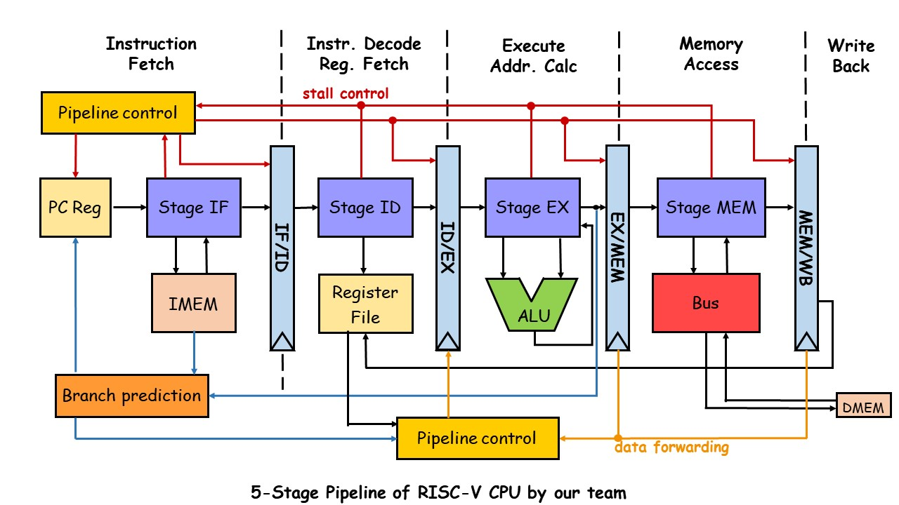
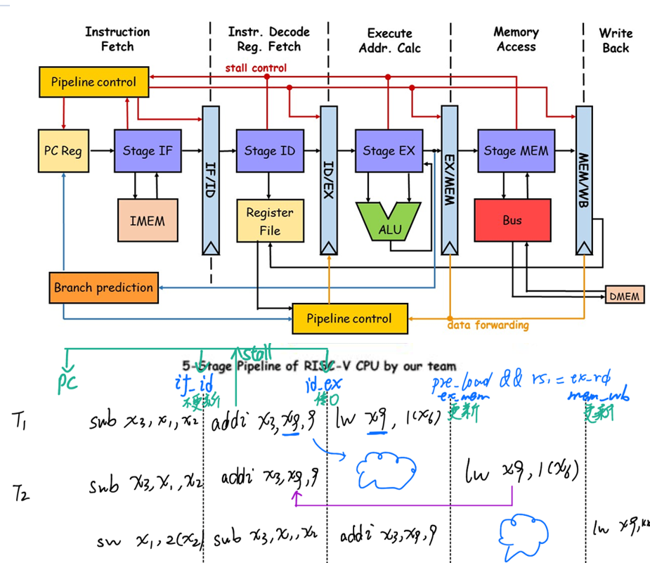
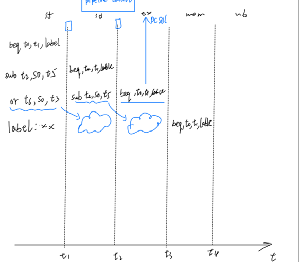
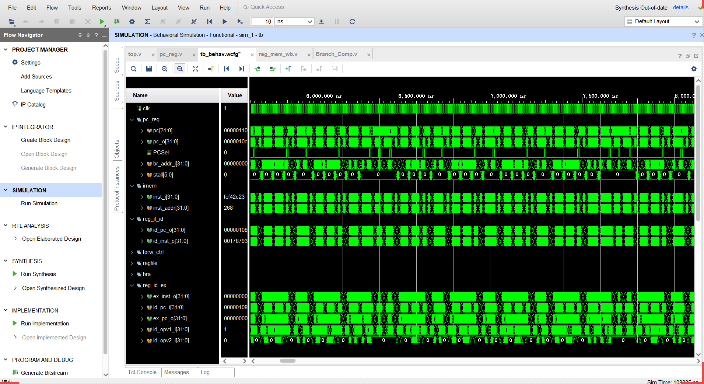
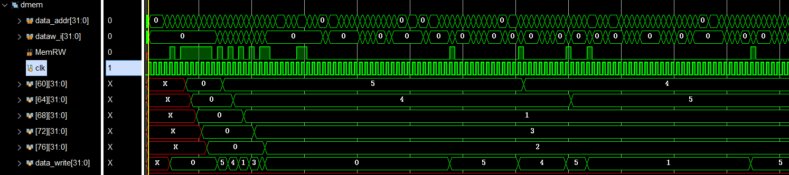
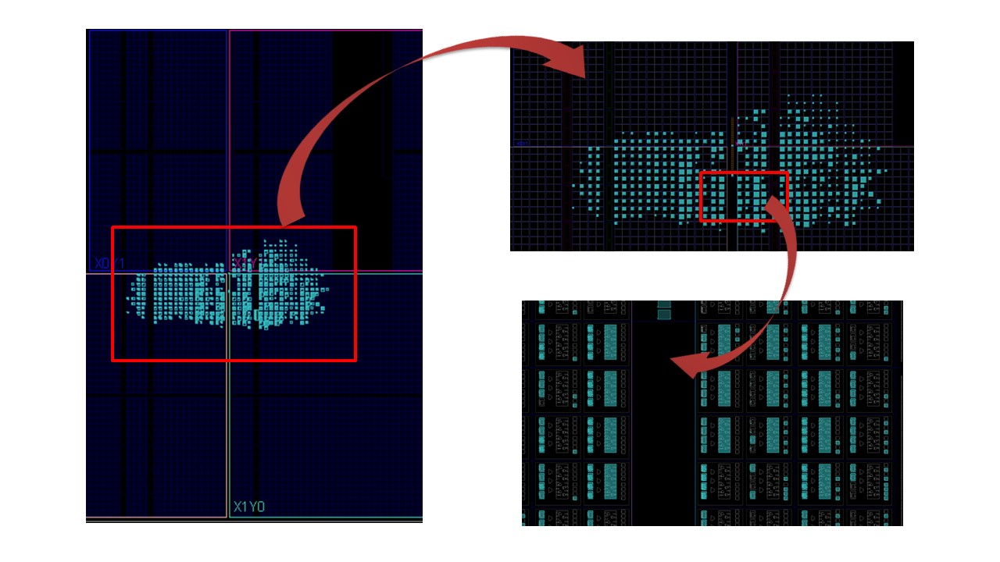
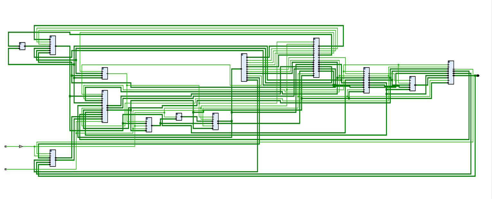

# RISC-V CPU

This project is a RISC-V CPU with 5-stage pipeline implemented in Verilog HDL, which is a course project of Smart chip Practice,  automation specialty @ Tongji University.

## Documents

* design: [**design**](doc/design.pdf) 
* report : [**report**](doc/report.pdf) 
* test excel:[**test.xlsx**](doc/test.xlsx) 
* Chinese manual：《RISC-V-Reader》中文版（第三方版权文档，本仓库未收录）

## Design
 Feature | RISC-V CPU
--- | ---
ISA | RISC-V ([RV32I subset](doc/inst-supported.md))
Pipelining | 5 stages
Data forwarding | √
Memory | Bus set associate DMEM,Ip core block ROM as IMEM 
Branch Prediction | Two - mode dynamic prediction 
UART module | passed simulation independently 

This CPU project has a five stage pipeline with data forwarding.
In the picture below, red paths show stall control flow, while orange ones show data forwarding path.

#### Analysis

**load stall** 

**branch stall** 

## Simulation
This CPU is simulated with bubble_sort in Xilinx vivado.

## Implementation
Implementation on Basys3 FPGA, using Xilinx vivado.

Scematic Overview

## References

*  https://github.com/Evensgn/RISC-V-CPU byZhou Fan
*  Class ppt : [**L04&05.pdf**](doc/L04&05.pdf) （very useful!）
*  《RISC-V-Reader》中文版（第三方版权文档，本仓库未收录）
*  tinyriscv: 一个从零开始写的极简、非常易懂的RISC-V处理器核。 - Gitee.com
*  𝑹𝑰𝑺𝑪-𝑽 基础 | suda-morris 个人博客
*  《手把手教你设计CPU——RISC-V处理器篇》

## Acknowledgements

- Mr. Chen and Mr. Wu
- @Yuanshiwuyu
- @Utrallyj for the guide of pipeline
- @cc and @rg for the tiny core
- @pupu for the interaction